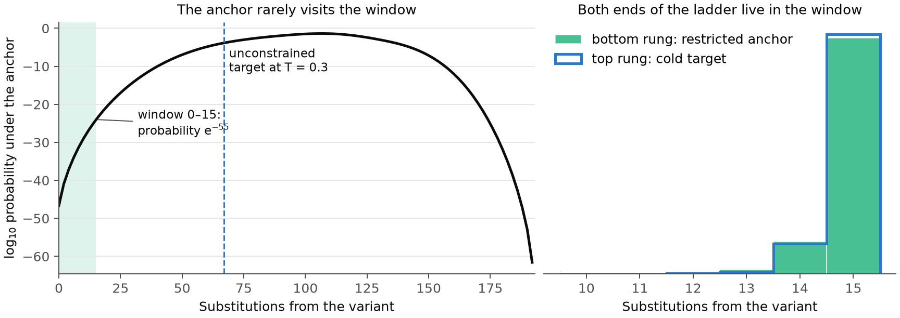
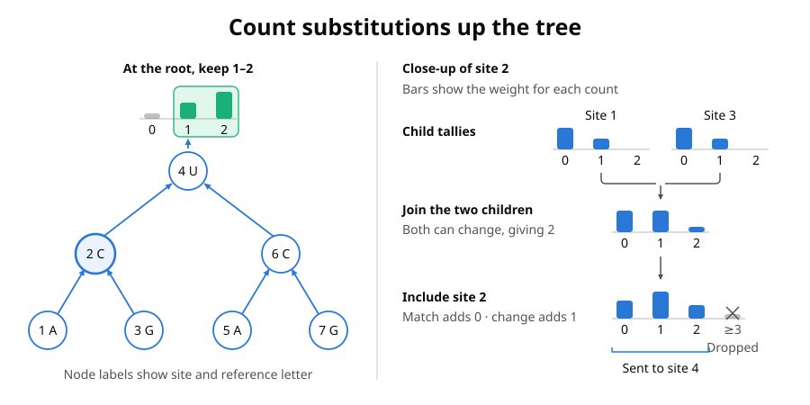
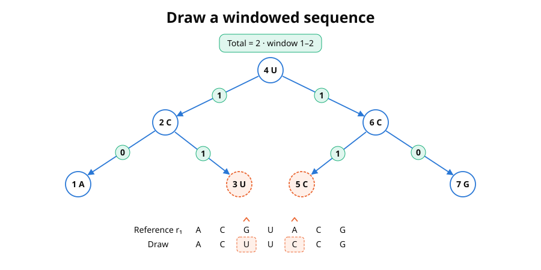
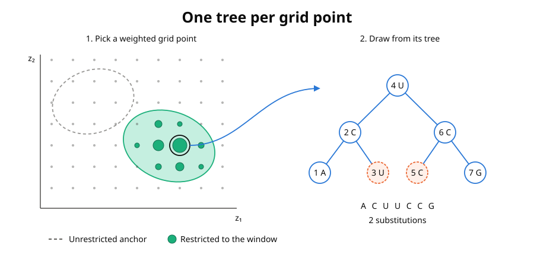
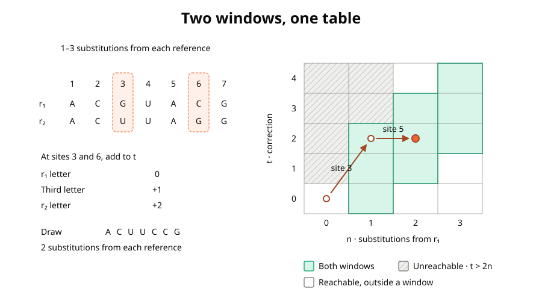

# The anchor

The **anchor** is the model at the bottom of every PTT ladder. Training starts from it, and the ladder keeps drawing fresh sequences from it, so its two essential properties are that its sequences can be **drawn exactly**, without Markov chains, and that its **normalization is known**. The independent-site profile has both properties but ignores every correlation between positions. The anchor keeps both properties and also captures a good part of the correlations. The ladder above it therefore needs fewer models.

This page explains what the anchor is, how it is fitted and sampled, and how it is restricted to the Hamming windows of [steered sampling](../usage/sample.md#steered-sampling-python). The mathematics is in [The anchor](../quantities/anchor.md) under Theory and definitions.

## Two simple models in one

The anchor combines two models that are each easy to sample and that miss opposite things.

- **A tree of pairs.** The positions are linked by \(L - 1\) pairwise couplings forming a tree: no loops, every position reached from a root along a single path. The tree is the one that carries the most mutual information in the alignment (Chow–Liu tree), so it holds the strongest local dependencies, such as the base pairs of an RNA. A tree is sampled exactly by drawing the root, then each position given its parent.
- **A few hidden directions.** \(K\) continuous hidden variables \(z\) (2 by default) act on all positions at once. They capture collective modes that no tree can hold, such as the split of a family into subfamilies. Given \(z\), the hidden directions only shift the fields of the tree.

To draw a sequence, the anchor first draws \(z\), then draws the tree with the fields that this \(z\) sets. The density of \(z\) lives in only \(K\) dimensions, so it can be covered with small boxes and sampled exactly by rejection, and its integral gives \(\log Z\).

## Fitting the anchor

The anchor is fitted to the alignment by maximum likelihood before PTT starts. Because its normalization is exact, so is the gradient of the likelihood: no sampling noise, and a standard optimizer converges in seconds to minutes. The fit starts from the Chow–Liu tree and from the leading modes of the correlation matrix, then adjusts the fields, the hidden directions and the tree couplings together.

| `--anchor` | Model | Fit, on a GPU |
|---|---|---|
| `tree-low-rank` (default) | Tree plus `--anchor-rank` hidden directions (2) | 29 s on RF00023 |
| `low-rank` | Hidden directions only | 30 s on BLAT with 2 directions, 12 min with 3 |
| `tree` | Tree only | 0.1 s, no optimization |
| `profile` | Independent sites | none |

On RF00023 (\(L = 374\)) the log-likelihood per site goes from −1.08 for the profile to −0.84 for the tree alone and −0.80 for the tree with two hidden directions. A better anchor shortens the ladder, but by less than its likelihood suggests: the distance it saves combines in quadrature with the distance that training still has to cover (see [The anchor](../quantities/anchor.md#at-the-bottom-of-the-ptt-ladder)).

## Restricting the anchor to Hamming windows

A steered PTT run keeps every rung inside the constraints, the bottom rung included. The bottom rung must therefore be the anchor **restricted to the windows**, still drawn exactly and still normalized.

Drawing from the full anchor and throwing away what falls outside does not work. In the Azoarcus group I intron model, the anchor puts its sequences about 105 substitutions away from a natural variant, and a window of at most 15 substitutions holds a fraction \(e^{-55}\) of its probability:

{ width="900" }

Instead, the window is built into the tree draw itself. The idea is to count substitutions while the tree is being processed, so that the draw already knows which choices keep it inside the window.

### Counting while passing messages

An exact tree draw has two passes. The first goes from the leaves to the root: each position sends its parent a **message**, which says, for every letter the parent might take, how much total weight the whole subtree below could carry. The second pass goes back down and draws the letters.

The figures below follow a toy example: seven RNA positions on a tree rooted at position 4, the reference `ACGUACG`, and a window of 1 to 2 substitutions.

For a window, each message also keeps a **tally**: the weight is split by how many substitutions the subtree uses. A position contributes one substitution if its letter differs from the reference. When a node collects the messages of its children, their tallies add up. Tallies above the window's maximum can never come back down, since substitutions only accumulate, so they are dropped as soon as they appear. At the root, the anchor knows exactly how much weight carries each total number of substitutions, and it keeps only the totals inside the window.

{ width="900" }

On the right, position 2 joins the tallies of its two children, then adds its own letter. Its message to the root keeps the counts 0, 1 and 2 and drops 3. At the root, only the counts 1 and 2 remain.

### Drawing inside the window

The second pass picks a total inside the window, then divides it among the branches of the root, in proportion to the weights that the first pass stored. Each branch then divides its share among its own branches, and every position draws its letter given its parent and its share. Every sequence lands inside the window on the first try, and with exactly the probability that the anchor gives it among the sequences of the window.

{ width="900" }

Here the root picks a total of 2, sends one substitution down each branch, and positions 3 and 5 end up substituted.

### The hidden directions

The tree draw happens at a fixed \(z\). The restricted anchor runs both passes at each point of a regular grid of \(z\) values and weighs each point by the total weight that its tree gives to the window. A draw first picks a grid point, then runs the tree draw there. The window can favour a different region of \(z\) than the unrestricted anchor does, so the grid is searched with the restricted weights. Each sequence contributes a smooth bump over \(z\), so the regular grid keeps a relative error below \(10^{-8}\), however rare the window is.

{ width="900" }

### Several windows

With two references, a single count is not enough. One count \(n\) follows the substitutions from the reference with the tightest window. A second count \(t\) changes only at the positions where the two references differ: it grows by 2 when such a position takes the letter of the second reference and by 1 for a third letter. Both distances can be read from \(n\) and \(t\), so each tally becomes a small table, and the windows become a region of that table. Windows on the same reference are merged, and windows that the other ones already guarantee are dropped.

{ width="900" }

In the example, the second reference differs from the first at positions 3 and 6, and both windows allow 1 to 3 substitutions. The drawn sequence takes the second reference's letter at position 3, which moves it by 1 in \(n\) and 2 in \(t\), then a substitution at position 5, where the references agree, which moves it by 1 in \(n\) only. It ends 2 substitutions from each reference. Cells with \(t > 2n\) can never be reached and are never stored.

### Cost

The tables are built once, when sampling starts, and every round then only repeats the downward pass. On an RTX A5000, for the Azoarcus model:

| Windows | Table | Preparation | 2,048 draws |
|---|---|---:|---:|
| 0–15 substitutions from a variant | 16 counts | 0.4 s | 20 ms |
| 5–10 from a variant and 25–30 from the wild type | 11 × 11 counts | 1.1 s | 30 ms |

The cost grows with the largest number of substitutions that must be counted, not with the width of the window. A window far from its reference counts matches instead, which are then fewer. With the restricted anchor at the bottom, the ladder needs no rungs below the anchor. In the steering benchmark at \(T = 0.3\) with a 15-substitution window, this removed four rungs, and after ten minutes 0.02 starting configurations per chain remained on the ladder, instead of 0.56.
