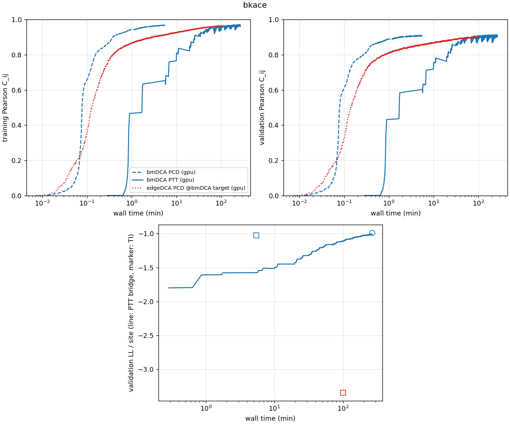
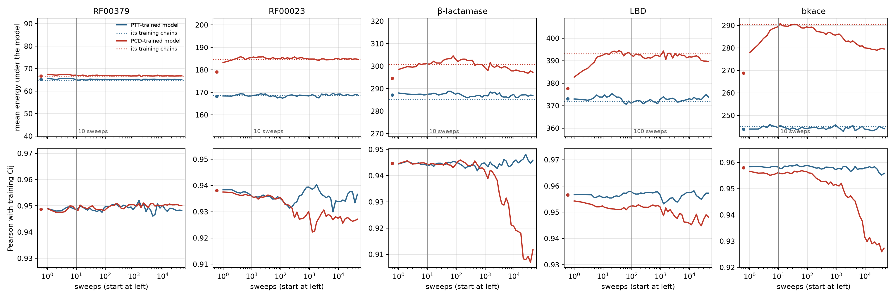
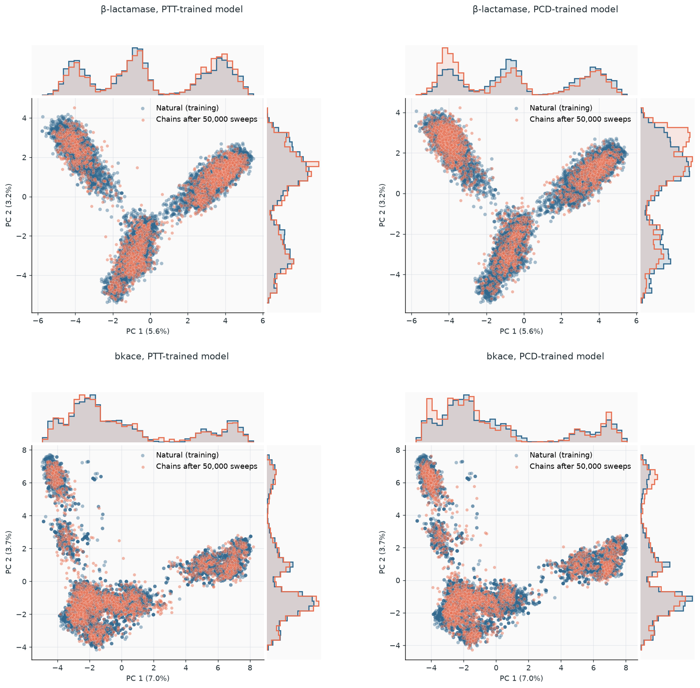

# Benchmarks

What to expect from adabmDCA on real data, and how the training strategies, model types, samplers and devices compare. Six families were trained and sampled with every combination of interest on one workstation (NVIDIA RTX A5000; AMD Threadripper PRO 5955WX, 16 threads for CPU runs), one job at a time so that wall times are comparable. A separate [MPS vs CPU](#mps-vs-cpu) comparison below uses an Apple M4 laptop.

## Setup

| Family | Type | L | q | Training sequences | M_eff | Validation sequences | M_eff |
| --- | --- | --- | --- | --- | --- | --- | --- |
| RF00379 | RNA | 136 | 5 | 2,908 | 1,109 | 738 | 429 |
| RF00023 | RNA | 374 | 5 | 6,484 | 2,686 | 1,621 | 937 |
| cm_russ_natural | protein | 96 | 21 | 901 | 573 | 225 | 225 |
| bkace | protein | 272 | 21 | 13,058 | 3,525 | 3,265 | 816 |
| LBD | protein | 279 | 21 | 13,864 | 1,149 | 6,945 | 5,415 |
| beta_lactamase | protein | 215 | 21 | 128,419 | 39,255 | 32,665 | 10,178 |

Each family was split 80/20 into training and validation sets by clustering at 80% identity. LBD's training set is far more redundant than its validation set (M_eff 1,149 vs 5,415), which partly explains its lower validation Pearson.

Protocol, per family, with default settings except `--nsweeps 100` for cm_russ_natural and LBD:

1. bmDCA with **PTT** and the validation set, stopping at the validation plateau;
2. bmDCA with **PCD**, with `--target` set to the training Pearson the PTT run ended with;
3. **edgeDCA** with PCD at the same target;
4. 2,000 sequences from each model: PTT sampling and plain MCMC for the PTT model, plain MCMC for the others, with `--plot` and the validation set as `-v`;
5. \(\log Z\) of every model by thermodynamic integration, so that PCD models also get a validation likelihood;
6. for the bmDCA models of RF00379, RF00023, beta_lactamase, LBD and bkace, 50,000 sweeps of plain MCMC started from the PTT samples and from training sequences ([Equilibrium of the trained models](#equilibrium-of-the-trained-models)).

Jobs had a 10-hour cap and PTT sampling a 3,000-round cap. The cap stopped LBD PTT training at update 3,582, with the validation likelihood still rising slowly, and bkace PTT sampling before renewal: its old fraction was still decreasing, but more and more slowly, and would have needed about 500 more rounds ([details](sampling.md#population-renewal)). Plain MCMC was given up to 10,000 sweeps. One seed per configuration: differences of a few thousandths in Pearson or about 0.01 nats per site in likelihood are within run-to-run and estimator noise.

## Training: PCD vs PTT

PCD was trained to the training Pearson the PTT run ended with. "First reaches" is when PTT's rolling mean first got there; PTT then continued to its validation plateau. Both models of a family were trained with the same settings:

| Family | `--nsweeps` (PTT and PCD) | Chains | Local sampler |
| --- | --- | --- | --- |
| RF00379 | 10 (default) | 2,000 | Metropolized Gibbs |
| cm_russ_natural | 100 | 2,000 | Metropolized Gibbs |
| RF00023 | 10 (default) | 2,000 | Metropolized Gibbs |
| beta_lactamase | 10 (default) | 2,000 | Metropolized Gibbs |
| bkace | 10 (default) | 2,000 | Metropolized Gibbs |
| LBD | 100 | 2,000 | Metropolized Gibbs |

| Family | Target Pearson | PTT total | PTT first reaches | PCD | PCD speed-up | Validation Pearson PTT / PCD |
| --- | --- | --- | --- | --- | --- | --- |
| RF00379 | 0.952 | 2.9 min | 2.9 min | 0.3 min | 9× | 0.806 / 0.801 |
| cm_russ_natural | 0.918 | 31 min | 30 min | 3.3 min | 9× | 0.604 / 0.609 |
| RF00023 | 0.942 | 58 min | 54 min | 1.7 min | 32× | 0.851 / 0.851 |
| beta_lactamase | 0.955 | 106 min | ≈ 106 min | 9.9 min | 11× | 0.942 / 0.945 |
| bkace | 0.968 | 267 min | 196 min | 5.4 min | 36× | 0.904 / 0.909 |
| LBD | 0.958 | 600 min (cap) | 506 min | 12.4 min | 41× | 0.826 / 0.842 |

Validation log-likelihood per site, both from thermodynamic integration for a like-for-like comparison:

| Family | PTT | PCD | PTT − PCD | Agreement of PTT bridge and TI |
| --- | --- | --- | --- | --- |
| RF00379 | −0.706 | −0.706 | 0.000 | 0.000 |
| cm_russ_natural | −1.477 | −1.479 | +0.002 | 0.007 |
| RF00023 | −0.643 | −0.646 | +0.003 | 0.009 |
| beta_lactamase | −1.328 | −1.357 | +0.029 | 0.001 |
| bkace | −0.988 | −1.023 | +0.035 | 0.015 |
| LBD (capped) | −1.677 | −1.702 | +0.025 | 0.012 |

By the training metrics, the two strategies are hard to tell apart. Both reach the same training Pearson, their validation Pearsons differ by at most 0.016, and on the three easier families their held-out likelihoods are equal. Only on the three large protein families does PTT end about 0.03 nats per site higher on held-out data, above the uncertainty of the estimate; it also reaches a much higher training likelihood (bkace −0.72 vs −0.84; LBD −0.86 vs −0.95), because it keeps fitting until the validation likelihood stops improving. None of these numbers says whether the data are the model's equilibrium: a PCD model's training Pearson is measured on its persistent chains. Sampling the final models answers that question.

[{ width="860" }](../figures/benchmarks/training_bkace.png)

*bkace, against wall time (log scale). PCD (dashed) reaches high Pearson within minutes. PTT (solid) starts after initialization, rises in steps as the ladder grows, and keeps improving the validation likelihood (bottom; line: PTT estimate during training, markers: thermodynamic integration of the final models) for hours. The PCD model's validation likelihood (blue square) is below PTT's final value (circle); the edgeDCA PCD model (red square) is far below.*

## Sampling from random sequences

The usual check is to sample the final model from random sequences and compare the samples with the data. Pearson of the generated vs training connected correlations, 2,000 sequences; × marks plain MCMC runs that did not reach a mixing time within 10,000 sweeps:

| Family | PTT model, PTT sampling | PTT model, MCMC | PCD model, MCMC | Time: PTT / MCMC |
| --- | --- | --- | --- | --- |
| RF00379 | 0.949 | 0.949 | 0.950 | 27 s / 17 s |
| cm_russ_natural | 0.908 | 0.904 | 0.890 | 56 s / 31 s |
| RF00023 | 0.938 | 0.931 | 0.923 | 16 min / 2 min |
| beta_lactamase | 0.945 | 0.928 × | 0.925 × | 27 min / 13 min |
| LBD | 0.956 | 0.813 × | 0.865 × | 32 min / 18 min |
| bkace | 0.962 | 0.702 × | 0.685 × | 62 min / 16 min |

- **PTT sampling works.** The sampled Pearson of every PTT model is close to its training value at equal sample size (training: 0.952, 0.918, 0.942, 0.955, 0.958, 0.968), on every family.
- **Where plain MCMC mixes, it agrees.** On RF00379, RF00023 and cm_russ_natural, plain MCMC reached its mixing time for every model, in half the time of PTT sampling or less, and matched PTT sampling within 0.007 for the PTT models. There the PCD models resample a little lower (RF00023 0.923 vs 0.931, cm_russ 0.890 vs 0.904).
- **On the three large families, plain MCMC does not mix, for either model.** On β-lactamase, LBD and bkace it did not reach a mixing time within 10,000 sweeps; on bkace its samples over- and under-populate data clusters by up to 2× (deviations up to 16 standard errors), while PTT samples match every cluster share within noise ([Sampling](sampling.md#plain-mcmc) shows the PCA projections). On these families the PCD models cannot be assessed this way: their low Pearsons are a sampling failure, which may or may not hide a model failure.

### Out-of-equilibrium training seen in resampling

Plain MCMC records the Pearson with the data at every sweep (`pearson_sampling.png`, `logs/sampling.log`). For a model whose equilibrium matches the data it rises and settles on a plateau. When it instead **rises above its final level and then declines**, the chains pass through a transient that matches the data better than the model's own equilibrium: the model reproduces the data at a finite sampling time, which is what training chains out of equilibrium produce. In these runs, declines of 0.005 or more appeared only for PCD-trained models (bmDCA on β-lactamase, bkace and RF00023; edgeDCA on RF00023 and cm_russ_natural), and for none of the nine PTT-trained models. On RF00023 the decline came after the mixing time had been reached: that criterion only checks that chains forget their recent past. The signature is indirect, though. It needs the decline to happen within the run, and a steady rise proves nothing: the LBD PCD model rises steadily, yet the next section shows it is out of equilibrium.

## Equilibrium of the trained models

To assess the models themselves, plain MCMC was started where sampling from random sequences cannot get. For each family, 2,000 chains were started from two sets of configurations, and both final bmDCA models ran 50,000 sweeps of Metropolized Gibbs from each, with the Pearson, slope and mean energy recorded every 250 sweeps (`sample --strategy pcd --init-sequences samples.fasta --nsweeps 50000 --record-every 250`):

- **The PTT samples of the PTT-trained model: each model against a known equilibrium.** These samples are at that model's equilibrium, certified independently by population renewal (bkace was resampled without the 3,000-round cap, and renewed after 3,600 rounds), and they match the data (training Pearson 0.94–0.96). For the PTT-trained model the run is the **control**: its equilibrium samples must not drift. For the PCD-trained model they are its equilibrium only if the two models agree. If they drift and lose agreement with the data, the PCD-trained model's equilibrium is not the data.
- **Training sequences drawn with their weights: the data themselves, and a second start.** No model reproduces the data exactly, so both move these sequences to a higher energy at first, and this start alone cannot rank them. What it shows is where each model ends up: when a model reaches the same state from the data as from the PTT samples, that state is its equilibrium, and a departure of the PCD-trained model is not an artefact of starting from the other model's samples.

From the PTT samples, start → end of the run (end: mean over the last 10,000 sweeps for the Pearson and the energy, the 50,000-sweep snapshot otherwise). Energy change is the chains' mean energy under the model being run, relative to the start. Cluster TV is the total-variation distance between the cluster shares of chains and data (k-means, 8 clusters on the first four principal components of the data):

| Family | Model | Train Pearson | Validation Pearson | Energy change | Cluster TV |
| --- | --- | --- | --- | --- | --- |
| RF00379 | PTT | 0.949 → 0.948 | 0.790 → 0.809 | −0.2 | 0.041 → 0.024 |
| | PCD | 0.949 → 0.950 | 0.790 → 0.800 | +0.1 | 0.041 → 0.049 |
| RF00023 | PTT | 0.938 → 0.937 | 0.839 → 0.832 | +0.7 | 0.068 → 0.067 |
| | PCD | 0.938 → 0.927 | 0.839 → 0.841 | +5.6 | 0.068 → 0.103 |
| beta_lactamase | PTT | 0.945 → 0.946 | 0.931 → 0.933 | −0.1 | 0.055 → 0.058 |
| | PCD | 0.945 → 0.911 | 0.931 → 0.897 | +2.7 (+6 at 1,000 sweeps) | 0.055 → 0.156 |
| LBD | PTT | 0.957 → 0.957 | 0.830 → 0.834 | +0.7 | 0.072 → 0.068 |
| | PCD | 0.957 → 0.948 | 0.830 → 0.824 | +12.0 (+16 at 1,000 sweeps) | 0.072 → 0.086 |
| bkace | PTT | 0.958 → 0.956 | 0.899 → 0.897 | +0.3 | 0.028 → 0.033 |
| | PCD | 0.958 → 0.927 | 0.899 → 0.877 | +10.7 (+19 at 1,000 sweeps) | 0.028 → 0.077 |

Along the PTT-model runs, the Pearson fluctuates with a standard deviation of 0.001–0.003 and the mean energy with 0.2–1.4.

[{ width="900" }](../figures/benchmarks/long_mcmc_relaxation.png)

*Chains started from the PTT samples, run with the PTT-trained (blue) and PCD-trained (red) models, averaged in bins evenly spaced in log(sweeps); the dot at the left is the start. Top: mean energy under the model being run, with the energy of each model's persistent chains at the end of training (dotted). Bottom: Pearson with the training correlations. Grey line: sweeps per training update (10; 100 for LBD). All panels of a row share the same vertical span. The PTT-trained model stays at its training chains' energy, which is its equilibrium, and keeps its Pearson. The PCD-trained model reaches its training chains' energy within the sweeps of one training update, with little change in Pearson; then, on β-lactamase, LBD and bkace, it sinks below that energy while the Pearson falls: its training chains were not at its equilibrium. On RF00379 neither model moves beyond the noise, and RF00023's PCD-trained model departs only in the first stage.*

- **Every PTT-trained model keeps its equilibrium samples**, on every measure, for 50,000 sweeps.
- **Four of the five PCD-trained models move them away.** Within the sweeps of one training update their chains settle at a higher energy, then the agreement with the data degrades: strongly on β-lactamase and bkace (training Pearson −0.03, validation −0.034 and −0.022, cluster shares shifted up to 1.5×), moderately on RF00023 (training Pearson −0.011, cluster TV 0.07 → 0.10, validation unchanged) and mildly on LBD (training Pearson −0.009). These models do not have the data as their equilibrium: their training Pearson was a property of the persistent chains.
- **RF00379's PCD model does not move**, in line with its matching held-out likelihood.
- LBD, trained with 100 sweeps per update, shows the mildest effect; with one family per setting, the number of sweeps cannot be told apart from the family itself.

**Why the energy of the PCD runs rises and then falls.** The persistent chains saved at the end of training show what each model was fitted to (dotted lines above). Mean energy under the PCD-trained model:

| | RF00023 | β-lactamase | LBD | bkace |
| --- | --- | --- | --- | --- |
| PCD training chains | 184.5 | 300.7 | 393.0 | 290.4 |
| Start (PTT samples) | 179.2 | 294.6 | 377.6 | 268.8 |
| After one update's sweeps (10; 100 for LBD) | 185.7 | 301.1 | 391.0 | 289.9 |
| After 50,000 sweeps | 185.4 | 297.5 | 390.9 | 278.0 |

The PTT-trained models' own training chains, by contrast, sit at their equilibrium energy (within 2 on every family).

- **Fast stage, within the training's sweeps per update.** The chains reach the energy of the PCD training chains within 2–10 sweeps (8–24 from the training data) and stay there for hundreds of sweeps, while the Pearson hardly changes. This locally relaxed state is what training worked with: each update moves the persistent chains by 10 sweeps (100 on LBD), and the parameters were adjusted until this state reproduced the data.
- **Slow stage, beyond it.** On β-lactamase, LBD and bkace the chains then sink below the training chains' energy over thousands to tens of thousands of sweeps, while the Pearson falls and the cluster shares shift. On β-lactamase and LBD this fall comes almost entirely from chains moving to clusters where the model's energy is lower; on bkace mostly from within the clusters. PCD only corrects what its chains visit, and lower-energy configurations they never reached during training were never penalized. On RF00023 the whole departure happens in the fast stage.

[{ width="860" }](../figures/benchmarks/long_mcmc_pca.png)

*Training data (blue) and chains after 50,000 sweeps from PTT samples (orange), on the first two principal components of the data, with marginal histograms. Left: PTT-trained model; right: PCD-trained model. Under the PTT-trained models the marginals still match the data. Under the PCD-trained models the chains stay inside the data's clusters but redistribute among them: on β-lactamase the cluster at PC1 ≈ −4 is over-populated by about 1.5× while the one at PC1 ≈ −1 thins out; on bkace the chains pile up in the group at PC2 ≈ 6.*

**Started from the training data.** Both models raise the energy of the training sequences within 250 sweeps, by 15 to 110 depending on the family, to the level of their own samples. Each model then ends where it ended from the PTT samples (Pearson within 0.004, energies within 2) on RF00379, RF00023, β-lactamase and LBD: the end states are the models' equilibria, and the PCD-trained models reach the same degraded state from either start. On bkace the Pearson stays about 0.01 higher from the data for both models (PTT 0.966 vs 0.956, PCD 0.931 vs 0.927) while the energies agree: there the chains equilibrate within clusters but still remember part of the data's cluster proportions after 50,000 sweeps. The PCD-trained model stays 0.03–0.035 below the PTT-trained one from either start. Under a bkace PTT model trained with 100 sweeps per update, the two starts agree ([10 vs 100 local sweeps](#10-vs-100-local-sweeps)).

**Mixing between clusters.** Cluster shares can only relax if chains move between clusters. Following each chain's cluster from snapshot to snapshot, the memory of the starting cluster (1: no chain has left it; 0: forgotten) is about 0 after 50,000 sweeps on RF00379, RF00023 and β-lactamase, 0.03–0.08 on LBD and 0.23–0.25 on bkace. On bkace the cluster shares are therefore only partly relaxed, and its PCD model's cluster drift is an underestimate. On LBD, whose PCA shows three well-separated islands, 70–80% of the chains visit another island during the run; the PCD model weights the islands like the PTT model, and departs from the data within them.

## Diversity and memorization

| Family | Validation: median nearest-neighbour distance (share < 0.1) | Generated (bmDCA, all variants) | Generated → training vs validation → training |
| --- | --- | --- | --- |
| RF00379 | 0.162 (33%) | 0.31–0.32 (0%) | 0.29 vs 0.23 |
| RF00023 | 0.182 (23%) | 0.385–0.388 (0%) | 0.36 vs 0.13 |
| cm_russ_natural | 0.448 (0%) | 0.458 (0%) | 0.41 vs 0.40 |
| beta_lactamase | 0.247 (28%) | 0.53–0.54 (0%) | 0.48 vs 0.24 |
| bkace | 0.077 (58%) | 0.38–0.40 (0%) | 0.35 vs 0.22 |
| LBD | 0.366 (9%) | 0.42–0.46 (0%) | 0.38–0.42 vs 0.43 |

- **No model reproduces the redundancy of natural data.** Natural validation sets contain many near-duplicates (up to 58% of sequences within 10% of another one); no generated set does, and PTT and PCD do not differ here. Most of the effect comes from reweighting, but not all: on RF00379, a model trained without reweighting generated 4.6% near-duplicates against 26% in the data, since a pairwise model cannot reproduce the phylogenetic structure of the alignment ([details](input.md#reweighting-and-the-redundancy-of-generated-sequences)).
- **All-pair distances match.** The distribution of distances between all pairs of generated sequences matches that of the validation set closely (mean quantile gap 0.005–0.05).
- **No memorization.** Generated sequences sit farther from the training set than held-out sequences do, or at a comparable distance (cm_russ_natural, LBD). The margin is largely a consequence of reweighting: without it, RF00379 samples sat exactly as close to the training set as held-out sequences, still with no identical sequence.

## bmDCA vs edgeDCA

| Family | Run | Time | Train / val Pearson | Density | Val LL (TI) | Resampled Pearson (MCMC) |
| --- | --- | --- | --- | --- | --- | --- |
| RF00379 | bmDCA PTT | 2.9 min | 0.952 / 0.806 | 1.00 | −0.706 | 0.949 |
| | edgeDCA PTT | 2.1 min | 0.892 / 0.781 | 0.13 | −0.712 | 0.892 |
| | edgeDCA PCD, edge target | 5 s | 0.892 / 0.782 | 0.08 | −0.736 | 0.884 |
| | edgeDCA PCD, bmDCA target | 7.0 min, step cap | 0.936 / 0.775 | 0.41 | unreliable | 0.928 × |
| RF00023 | bmDCA PTT | 58 min | 0.942 / 0.851 | 1.00 | −0.643 | 0.931 |
| | edgeDCA PTT | 77 min | 0.901 / 0.826 | 0.14 | −0.681 | 0.897 |
| | edgeDCA PCD, bmDCA target | 33 min, step cap | 0.905 / 0.814 | 0.27 | unreliable | 0.887 × |
| cm_russ_natural | bmDCA PTT | 31 min | 0.918 / 0.604 | 1.00 | −1.477 | 0.904 |
| | edgeDCA PTT | 36 min | 0.811 / 0.531 | 0.32 | −1.615 | 0.801 |
| | edgeDCA PCD, bmDCA target | 1.2 min | 0.919 / 0.572 | 0.23 | unreliable | 0.701 × |
| beta_lactamase | edgeDCA PCD, bmDCA target | 36 min, step cap | 0.837 / 0.828 | 0.03 | unreliable | 0.815 × |
| bkace | edgeDCA PCD, bmDCA target | 101 min, step cap | 0.964 / 0.900 | 0.31 | unreliable | 0.507 × |
| LBD | edgeDCA PCD, bmDCA target | 36 min | 0.958 / 0.850 | 0.11 | unreliable | 0.548 × |

("Step cap": stopped at the default 50,000 graph updates before reaching the target.)

- **edgeDCA with PTT** took as long as bmDCA or longer, stopped at a lower Pearson, and had an equal or lower validation likelihood. Its archives accumulated many models, which made PTT sampling expensive: on RF00023, 47 models and 89 minutes of sampling without reaching renewal.
- **edgeDCA with PCD** is very fast to a moderate target. At bmDCA-level targets, 4 of 6 families exhausted the step budget (beta_lactamase stalled at 0.84 with 3% density), and **the models did not mix**: their resampled Pearsons fell far below training (bkace 0.51 vs 0.96, LBD 0.55 vs 0.96, cm_russ 0.70 vs 0.92). Their energy scales were extreme (mean training energy from −100 to −9,200, against +50 to +300 for every other model) and thermodynamic integration returned meaningless \(\log Z\) values. The good training Pearson was a property of the persistent chains, not of the model's equilibrium. The cm_russ model also generated sequences unusually close to the training data (median nearest-training distance 0.23 vs 0.40 for held-out sequences), the only sign of collapse in the whole study.

For these families, bmDCA is better than edgeDCA in accuracy, robustness and total cost. Sparse models are worth it only when sparsity itself is the goal. PTT no longer accepts edgeDCA.

## Sampling kernels

For Apple GPUs, see [MPS vs CPU](#mps-vs-cpu) below.

Time per sweep, 2,000 chains, comparing the original PyTorch samplers with the current ones (Triton on GPU, Numba on CPU):

| Model | Device | Gibbs | Metropolis | Metropolized Gibbs |
| --- | --- | --- | --- | --- |
| RF00379 bmDCA | GPU | 23.7 → 0.56 ms (42×) | 17.0 → 0.23 ms (74×) | 35.4 → 0.62 ms (57×) |
| RF00379 bmDCA | CPU | 65.9 → 9.4 ms (7×) | 44.8 → 2.2 ms (21×) | 62.4 → 9.5 ms (7×) |
| cm_russ bmDCA | GPU | 18.1 → 0.75 ms (24×) | 16.0 → 0.45 ms (35×) | 28.3 → 0.75 ms (38×) |
| cm_russ bmDCA | CPU | 152 → 14.2 ms (11×) | 74.4 → 2.1 ms (36×) | 96.4 → 14.7 ms (7×) |

The optimized kernels produce the same Markov chain as the originals (identical decorrelation curves, see [Sampling](sampling.md#local-moves)).

Cost of one independent sample (energy correlation time × time per sweep, 2,000 chains):

| Model | GPU Gibbs | GPU Metr. Gibbs | GPU Metropolis | CPU Gibbs | CPU Metr. Gibbs | CPU Metropolis |
| --- | --- | --- | --- | --- | --- | --- |
| RF00379 (τ ≈ 5 / 7 / 16 sweeps) | 2.9 ms | 4.6 ms | 3.7 ms | 48 ms | 71 ms | 34 ms |
| cm_russ (τ ≈ 71 / 93 / 818 sweeps) | 54 ms | 70 ms | 365 ms | 1.0 s | 1.4 s | 1.7 s |

**Sparse kernels.** For sparse models, kernels that read only the coupled pairs are selected automatically: on CPU while at most half of the pairs are coupled, on GPU while every position is coupled to at most 40% of the others (60% for Metropolis). On CPU they were 2.3–4× faster for Gibbs-type samplers at 13–32% pair density; on GPU at most 1.5×, and Metropolis was slightly slower. `ADABMDCA_SPARSE=0` forces the dense kernels; results are identical up to floating-point rounding.

## GPU vs CPU

bmDCA training with identical settings on the GPU and on the CPU (16 threads, Numba kernels). Training times exclude loading and setup:

| Family | Strategy | GPU | CPU | GPU speed-up | Same outcome? |
| --- | --- | --- | --- | --- | --- |
| RF00379 | PCD | 19 s | 5.1 min | 16× | Yes: target Pearson 0.952 reached after 2,280 (GPU) and 2,243 (CPU) updates |
| cm_russ_natural | PCD, 100 sweeps | 3.3 min | 39 min | 12× | Yes: target Pearson 0.918 after 2,325 and 2,339 updates |
| RF00379 | PTT | 2.9 min | 35 min | 12× | Yes: validation plateau after 2,475 and 2,632 updates; validation log-likelihood −0.711 per site on both |

The two devices draw different random numbers, so the trajectories differ in detail, but they reach models of the same quality in a similar number of updates. Per sampling sweep, the GPU is 15–20× faster for Gibbs and Metropolized Gibbs and 5–9× for Metropolis, which is cheap on CPU. A small RNA family trains on a CPU in minutes with PCD and in about half an hour with PTT; protein families of a few hundred positions need a GPU.

## MPS vs CPU

Optimized Apple Metal kernels have been written for MPS sampling. They are
selected automatically on supported Apple GPUs and are used by both PCD and PTT.

This comparison uses a **MacBook Air with an Apple M4**: a 10-core CPU
(4 performance and 6 efficiency cores), an 8-core Apple GPU and 16 GB of unified
memory. CPU runs use the optimized Numba kernels with **4 threads**; MPS runs
use the optimized Apple Metal kernels. This is a laptop, separate from the
Threadripper/RTX A5000 workstation used above. Runs use PyTorch 2.13.0,
float32, with one job running at a time.

**Sampling.** Time per sweep for 2,000 chains on the same dense bmDCA model,
measured over 10 sweeps after warmup; median of three calls, including the
sampler's input/output conversions:

| Family | Sampler | CPU (Numba) | MPS (Apple Metal) | MPS speed-up |
| --- | --- | --- | --- | --- |
| RF00379 | Gibbs | 20.7 ms | 5.6 ms | 3.7× |
| RF00379 | Metropolis | 6.4 ms | 2.1 ms | 3.1× |
| RF00379 | Metropolized Gibbs | 21.9 ms | 5.7 ms | 3.9× |
| cm_russ_natural | Gibbs | 59.4 ms | 12.4 ms | 4.8× |
| cm_russ_natural | Metropolis | 9.0 ms | 8.5 ms | 1.1× |
| cm_russ_natural | Metropolized Gibbs | 48.7 ms | 5.9 ms | 8.3× |

**PCD training.** Dense bmDCA, 2,000 chains, **10 sweeps per update for both
families**, Metropolized Gibbs, learning rate 0.01, seed 0 and sequence
reweighting at 80% identity.
The target Pearsons match the endpoints of the earlier PTT runs. Training
uses the same `example_data` training/validation splits listed in the setup
above. Times exclude loading, setup and compilation.

| Family | Target Pearson | CPU (Numba) | MPS (Apple Metal) | MPS speed-up | Updates CPU / MPS |
| --- | --- | --- | --- | --- | --- |
| RF00379 | 0.952 | 8.1 min | 2.5 min | 3.3× | 2,221 / 2,226 |
| cm_russ_natural | 0.918 | 14.1 min | 4.7 min | 3.0× | 2,314 / 2,339 |

Both devices reached the requested targets. Their random streams differ,
so the update counts need not match. These are single training runs; speed-ups
apply to this laptop and these settings. In particular, the protein run uses
10 sweeps here, versus 100 in the workstation comparison above. Reaching the
training Pearson alone does not establish equilibrium or equal validation quality.
The [measurement record](../assets/benchmarks/mps-cpu-convergence-m4.json) contains
the individual sampling timings and final training metrics.

## 10 vs 100 local sweeps

On bkace, bmDCA PTT with 100 local sweeps per round was compared with the 10-sweep reference over updates 1,000–6,000 (the 100-sweep run stopped at the 10-hour cap):

| | 10 sweeps | 100 sweeps |
| --- | --- | --- |
| Update-to-update noise of Pearson / val Pearson / slope | 0.0024 / 0.0039 / 0.031 | 0.0013 / 0.0024 / 0.019 |
| Chain lag, median / max | 0.022 / 0.20 | 0.007 / 0.06 |
| Lag pauses | 2 | 0 |
| Smallest swap acceptance | Pinned at 0.25 from update ~2,000 | Regular saw-tooth, 0.25–0.45 |
| Log-likelihood per site at update 6,000, train / val | −0.949 / −1.079 | −0.869 / −1.038 |
| Time per update | 1.0 s | 6.0 s |
| Best validation log-likelihood | −1.008 at the plateau (4.4 h) | −1.038 at the cap (10 h) |

More local work gives a smoother optimization and more progress per update, but costs about 6× more per update, so 10 sweeps reach a given validation likelihood sooner. The [training page](training.md#a-larger-family-what-10-and-100-sweeps-look-like) shows the curves. On cm_russ_natural, in contrast, 10 sweeps failed outright ([F1](diagnostics.md#f1-a-narrow-basin-traps-configurations)) and 100 were needed.

Both models keep their own equilibrium samples over 50,000 sweeps of plain MCMC (tested as in [Equilibrium of the trained models](#equilibrium-of-the-trained-models)). Training with 100 sweeps per update removes the drift of runs started from the training data: under the 100-sweep model they end at the Pearson of its PTT samples (0.961 vs 0.962), while under the 10-sweep model they stay about 0.01 above it.

## Summary

| Question | Answer from these families |
| --- | --- |
| PCD or PTT for bmDCA? | PTT for the reference model, PCD for a fast first pass. Same held-out likelihood on easy families, yet 4 of 5 PCD models drifted away from equilibrium samples while every PTT model kept them; PTT better by ~0.03 nats/site on large proteins |
| How to sample? | PTT from the training archive whenever plain MCMC does not report a reached mixing time |
| bmDCA or edgeDCA? | bmDCA |
| Which sampler? | Gibbs or Metropolized Gibbs |
| GPU or CPU? | GPU for protein families; CPU is fine for small RNA families |
