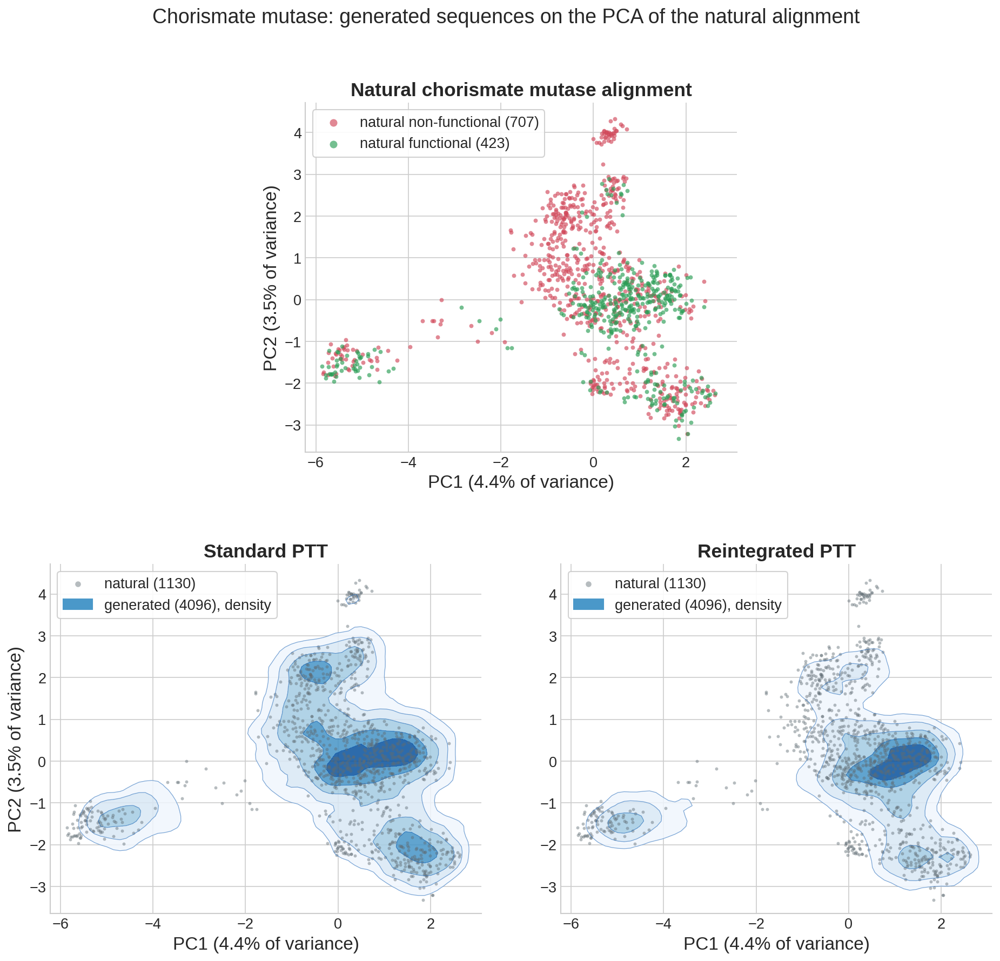
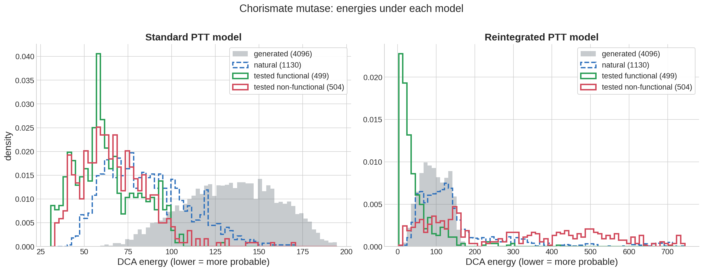

# Retrain with experimental feedback · `reintegrate`

When some generated or designed sequences have been tested experimentally, their results can be fed back into training, as in [Calvanese et al. (2025)](https://arxiv.org/abs/2504.01593). Sequences that worked pull the model toward them; sequences that failed push it away. In that study, reintegration raised the fraction of functional designs.

```bash
adabmDCA reintegrate -d natural.fasta --reint tested.fasta --adj adjustments.txt -o reintegrated
```

## Inputs

| Option | Meaning |
| --- | --- |
| `-d` | Natural alignment, as for `train` |
| `--reint` | Tested sequences, aligned like the natural ones |
| `--adj` | Text file with one number per tested sequence, in the same order: `1` for a sequence that passed the test, `-1` for one that failed. Values in between grade the outcome |
| `--lambda_` | Strength of the experimental term. Default `1 / max|adj|`, which is 1 for ±1 adjustments |

The training options of [`train`](train.md) are accepted (model type, sweeps, chains, validation set, …). A good starting point is ±1 adjustments with `--lambda_ 1`; raise \(\lambda\) to give the experiments more influence over the natural data.

!!! note "Reintegration trains with PCD by default"
    Unlike `train`, `reintegrate` uses PCD unless `--strategy ptt` is given; the `--ptt-*` options of `train` then apply, for bmDCA, eaDCA and edgeDCA. Check a PCD result by sampling it with `sample --strategy pcd` and making sure it mixes.

## What it does

The natural sequences keep their usual weights \(w_m\), normalized by \(M_{\rm eff}\). Each tested sequence \(r\) gets the weight \(\lambda\,a_r/N_{\rm exp}\) relative to the natural data, where \(a_r\) is its adjustment and \(N_{\rm exp}\) the number of tested sequences. The model is then trained on the combined, signed weights, which amounts to maximizing the likelihood of the natural sequences plus \(\lambda\) times the average of \(a_r \log p(y_r)\) over the tested ones. See [the derivation](../algorithms/analysis.md#experimental-reintegration).

With strong negative adjustments, some combined pair frequencies can become negative; they are clipped to zero before the pseudocount is added. The model then departs from the formal objective, so very large \(\lambda\) values are not recommended.

## Example: chorismate mutase

The natural alignment has 1130 chorismate mutase sequences (L = 96), 423 of them labelled functional. The 1003 tested sequences carry ±1 adjustments, 499 of them positive. Both models are bmDCA trained with PTT, 100 sweeps per update, until the Pearson correlation reaches 0.9; 4096 sequences were then sampled from each archive with `sample --strategy ptt`:

```bash
adabmDCA train --strategy ptt -d natural.fasta -o standard --nsweeps 100 --target 0.9
adabmDCA reintegrate --strategy ptt -d natural.fasta --reint tested.fasta --adj adjustments.txt \
    -o reintegrated --nsweeps 100 --target 0.9
```

[{ width="760" }](../figures/chorismate_mutase/pca_comparison.png)

In the natural alignment, functional sequences gather in the central cluster and the island on the left, while non-functional ones dominate the upper region and the small cluster at the top. The model trained on the natural sequences alone covers every cluster, non-functional regions included. The reintegrated model concentrates on the central functional cluster and the left island and nearly abandons the upper region. As a consequence, its samples reproduce the statistics of the natural alignment less closely (Pearson 0.63 against 0.91): it no longer models the non-functional part of the family.

[{ width="980" }](../figures/chorismate_mutase/energy_histograms.png)

Under the standard model, functional and non-functional tested sequences have the same energy distribution, so the model cannot tell them apart. The reintegrated model separates them into two groups: functional sequences sit in a narrow peak at low energy, below the generated ones, while non-functional sequences spread to energies several hundred units higher. The natural sequences, whose labels were not used in training, are separated too: the mean energy gap between functional and non-functional ones grows from −1 to −99. Energies are comparable within a panel only, since each model fixes its own energy scale.

## Outputs

The usual training outputs ([`train`](train.md#outputs)), plus the combined alignment and its signed weights, named after the resolved \(\lambda\) (for example `reintegrated-lambda_1.00_msa.fasta` and `reintegrated-lambda_1.00_weights.dat`), and a reintegration summary in JSON. Check that the adjustments line up with the tested sequences in the combined files before interpreting the model.

## In Python

```python
import numpy as np
from adabmDCA import load_alignment, reintegrate_model

result = reintegrate_model(
    load_alignment("natural.fasta"), load_alignment("tested.fasta"),
    np.loadtxt("adjustments.txt"), output_dir="reintegrated",
)
print(result.lambda_value, result.training.stop_reason)
```
