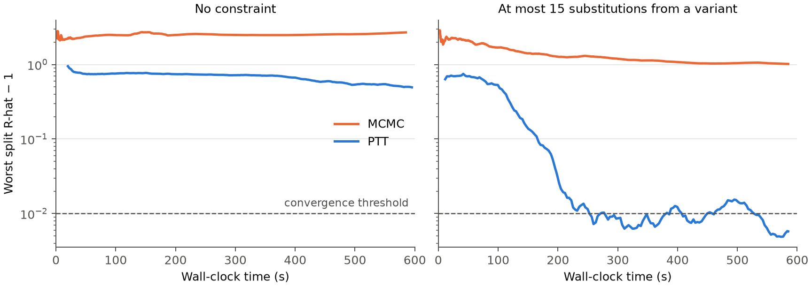
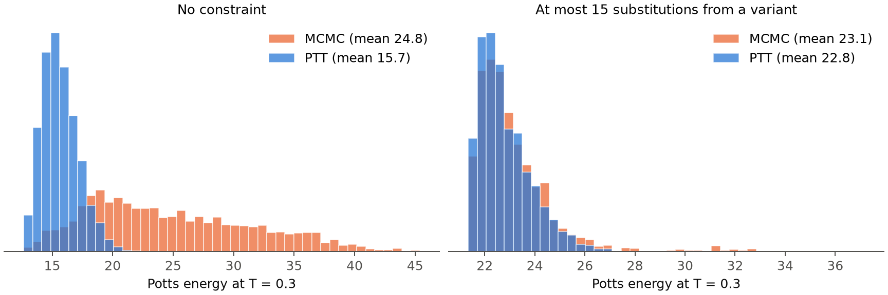
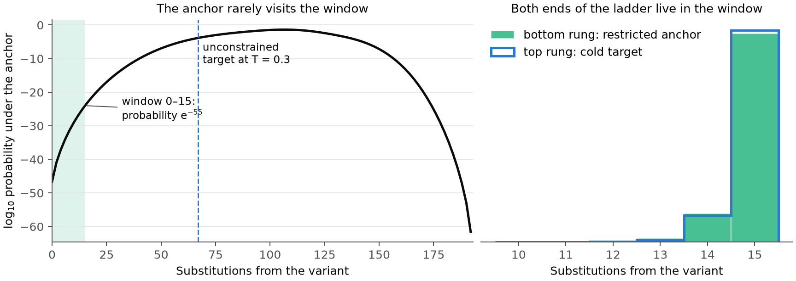

# Steered sampling

Steering samples a DCA model under extra requirements on the sequences: stay
within a number of substitutions of a reference, avoid gaps, prefer sequences
that fold, or run colder than the model. You describe the requirements with a
`SteeringConfig` and pass it to `sample_sequences`. Two samplers are available:

- **MCMC** runs a population of chains on the steered model alone.
- **PTT** runs a ladder of models, from the exactly sampled anchor of a
  training archive up to the steered target, and exchanges sequences between
  neighbouring rungs.

## The target

Steering samples, among the allowed sequences, the distribution
\(p(x) \propto e^{-u(x)}\) with the reduced energy

\[
u(x) = \beta H(x) + \sum_k b_k\, d(x, r_k) + \sum_j \lambda_j V_j(x).
\]

\(H\) is the Potts energy of the model and \(\beta\) the inverse temperature.
\(d(x, r_k)\) is the number of substitutions from a reference \(r_k\), with
weight \(b_k\). Each \(V_j\) is a cost computed by your own function, with
weight \(\lambda_j\). The allowed sequences are those that use only allowed
letters and fall inside every distance window.

The requirements therefore come in two kinds. **Constraints** are hard: a
sequence that breaks one has probability zero, and inside them the model keeps
its own relative probabilities. **Potentials** are soft: they reweight
sequences without excluding any.

## Constraints and potentials

| Object | Kind | Effect |
|---|---|---|
| `allowed_tokens="ACGU"` | Constraint | Only these letters at every site, for example no gaps in an RNA model. |
| `HammingWindow(reference, minimum, maximum)` | Constraint | Between `minimum` and `maximum` substitutions from `reference`, inclusive. Several windows must all hold. |
| `HammingBias(reference, weight)` | Potential | Adds `weight` per substitution from `reference`. A positive weight favours nearby sequences. |
| `WeightedPotential(callback, weight)` | Potential | Adds `weight` times the value your callback returns for each sequence. |
| `beta` (argument of `sample_sequences`) | Temperature | Values above 1 sharpen the model, below 1 flatten it. The biases and potentials keep their weights. |

References and sequences are aligned and have the model length. A callback
receives a batch and returns one finite number per sequence. It gets a list of
strings by default, or an integer array of token indices with
`input="categorical"`. It must be deterministic, because values are cached.

The costs differ. Constraints and Hamming biases are applied inside each site
update and cost almost nothing. A callback is called once per changed
sequence and per update block. An expensive callback, such as a folding
energy that takes tens of milliseconds, sets the speed of the whole run.

## Sample with MCMC

This small independent-site model needs only PyTorch and adabmDCA. In an
experiment, use a trained `DCAModel` or a parameter path.

```python
import torch
from adabmDCA import DCAModel, HammingWindow, SteeringConfig, sample_sequences

model = DCAModel(
    {"bias": torch.zeros(6, 5), "coupling_matrix": torch.zeros(6, 5, 6, 5)},
    alphabet="rna",
)
shell = SteeringConfig(
    allowed_tokens="ACGU",
    windows=(HammingWindow("ACGUAC", 1, 2),),
    chains=32,
)
draws = sample_sequences(model=model, steering=shell, n_sequences=128, n_sweeps=256)
print(draws.sequences[:3], draws.steering["status"])
```

Every sequence has one or two substitutions from the reference and contains
only A, C, G and U.

The chains never leave the allowed set. Each site update draws its new letter
from the model's conditional probability restricted to the letters that keep
every distance inside its window. A running count of substitutions per window
makes this check free. Callbacks enter afterwards: a block of such updates is
proposed and accepted with probability \(\min(1, e^{-\Delta V})\), where
\(\Delta V\) is the change in the weighted callback costs. The sites of a block
are visited in an order mixed with its reverse, so the move is exact for the
steered target.

## Sample with PTT

Pass `ptt=True` with a training archive:

```python
from adabmDCA import HammingWindow, SteeringConfig, sample_sequences

config = SteeringConfig(
    allowed_tokens="ACGU",
    windows=(HammingWindow(variant, 0, 15),),
    chains=2048,
    production_spacing=0,
    warmup_seconds=600,
)
result = sample_sequences(
    model="model/ptt.h5", ptt=True, steering=config,
    beta=1 / 0.3, n_sequences=2048, device="cuda",
)
```

The ladder has three parts, and every rung obeys the constraints:

1. **The anchor, restricted to the constraints.** The bottom rung is redrawn
   from scratch in every round, with independent exact draws.
2. **The archived models.** The checkpoints that training stored, from the
   anchor to the trained model.
3. **The steering ramp.** Above the trained model, the inverse temperature
   moves from 1 to `beta`, and the biases and callback weights grow from zero to
   their targets, in `ladder_steps` increments.

In each round every rung above the bottom makes one constrained update block,
and neighbouring rungs try to swap their sequences. Fresh sequences from the
bottom climb the ladder, and old ones are pushed out. Before warmup, a short
pilot inserts intermediate rungs where swaps are rarely accepted
(`min_swap`, `max_rungs`).

A standalone model also works, but the archive gives the better ladder. The
call `sample_sequences(model="model/ptt.h5", ptt=True, beta=1.25,
n_sequences=128)` without `steering` builds a pure temperature ladder.

With `entropy=True`, PTT also estimates \(\log Z\) and the entropy of the
steered target. It starts from the exactly known normalization of the bottom
rung and adds the free-energy differences between neighbouring rungs.

`initial_sequences` seeds every rung above the bottom, for example with a
gap-free sample drawn at a warmer temperature. The seeds must satisfy the
constraints, and you need at least `chains` of them. Seeds count as old
configurations until fresh lineages from the bottom replace them.

## When to use PTT

MCMC is enough when the target is close to the model: temperature near 1, wide
windows, weak potentials. It is also the quick choice for a first look.

Use PTT when one of these holds:

- **Low temperature.** A cold model has deep, separated minima. Chains settle
  in the first one they find.
- **Narrow windows far from typical sequences.** A window of a few
  substitutions around a variant is a small, rugged region, and chains that
  enter it rarely cross it.
- **Several modes matter.** Independent chain groups that disagree
  (high R-hat) are the sign of a target with several modes.
- **You need \(\log Z\) or the entropy** of the steered target.

The comparison below sampled the Azoarcus group I intron model (\(L = 193\),
gap-free) at \(T = 0.3\) with 2,048 chains for about ten minutes per run,
without a window and with at most 15 substitutions from a natural variant.

{ width="900" }

MCMC never approached the convergence threshold. Without a window, neither
sampler converged in ten minutes, but PTT reached a much lower R-hat. With the
window, PTT passed the R-hat and ESS checks after about 250 s. After about
420 s, fewer than 0.1 old configurations per chain remained on the ladder.

{ width="900" }

The final populations show what the R-hat warns about. Without a window, the
MCMC chains stayed stuck about 9 energy units above the PTT sequences. Inside
the window the two distributions are closer, but MCMC keeps a tail of chains
trapped at high energy.

## How the bottom rung respects the constraints

The bottom of the PTT ladder must be a model whose samples are exact and
independent and whose normalization is known. The anchor that training starts
from has both properties. It is a tree of strong pairwise couplings plus a few
hidden directions that capture collective modes (see [The anchor](../quantities/anchor.md)).
With constraints, the bottom rung must also live inside them.

Drawing from the anchor and throwing away the draws outside the window does
not work. The anchor puts its sequences about 105 substitutions away from the
variant, and the window holds a fraction \(e^{-55}\) of its probability.

{ width="900" }

Instead, the anchor is conditioned directly. Picture the tree as a family tree
of sites. To draw a sequence, the anchor passes messages from the leaves to the
root. Each message summarizes, for every letter of the parent, the total weight
of all the ways the subtree below could be filled in. For a window, each message
also keeps a tally: the weight is split by how many substitutions the subtree
uses. Joining two subtrees adds their tallies. Tallies above the window's
maximum can never come back down, so they are dropped at once. At the root, the
anchor knows exactly how much weight each total number of substitutions
carries, and keeps only the totals inside the window.

The draw then goes back down. It picks a total inside the window, then divides
it among the branches of the root, then among the branches of each branch,
choosing each letter on the way. Every sequence lands inside the window on the
first try. The hidden directions are handled by repeating this for a set of
values of the hidden variables, as for the unrestricted anchor.

With several windows, each tally becomes a small table. One count follows the
substitutions from the tightest reference. Each other reference adds a count
that changes only at the sites where the two references differ. In practice
the conditioning is cheap. For the window above, it takes 0.4 s to prepare on
a GPU, and 2,048 fresh draws take about 20 ms per round. For 5–10
substitutions from one variant and 25–30 from the wild type, preparation takes
1.1 s, and 2,048 draws take 30 ms.

The ladder needs no rungs below the anchor. As the right panel shows, the bottom
rung already samples the same window as the cold target at the top. The
details are in [The anchor](../quantities/anchor.md#restricted-to-hamming-windows).

## Check warmup and read the result

Both samplers split the chains into independent groups (`groups`) and monitor
rank-normalized split R-hat and bulk and tail ESS of each group's mean
energy, distances and a random projection of the sequences. PTT also requires
the old configurations to be renewed. At most `ptt_renewal_tolerance` sequences
per chain, summed over the whole ladder, may still descend from the starting
population.

`n_sweeps` limits MCMC warmup and `ptt_max_rounds` limits PTT warmup.
`warmup_seconds` adds a wall-clock limit. A run that reaches a limit before
passing the checks returns its sequences with the status
`warmup_budget_exhausted` or `warmup_time_exhausted`. Treat those sequences as
provisional. `production_spacing=0` takes a single snapshot at the end of
warmup, with at most one sequence per chain.

```python
import matplotlib.pyplot as plt

history = result.steering["history"]
warmup = history["warmup"]
plt.plot([row["elapsed_seconds"] for row in warmup],
         [row["observables"]["reduced_energy"] for row in warmup])
plt.xlabel("Seconds")
plt.ylabel("Mean reduced energy")
result.to_json("steered.json")
```

`result.steering` keeps the warmup trace, the diagnostic checks, the retained
production batches and, for PTT, the ladder, swap rates and renewal records.
With `entropy=True` it also keeps the running \(\log Z\) and entropy
estimates. See the [steering API reference](../api/adabmDCA.steering.sampling.md)
for every field.
